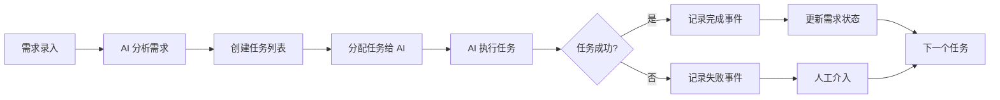

# OpenTask

<div align="center">

**AI 驱动的研发管理平台 - 为 AI Agent 设计的任务协作系统**

An AI-powered R&D management platform designed for autonomous agent collaboration.

[](https://python.org)
[](https://fastapi.tiangolo.com)
[](https://vuejs.org)
[](https://www.typescriptlang.org)
[](LICENSE)

</div>

---

## 项目简介

**OpenTask** 是一个专为 **AI Agent** 设计的协同研发管理平台。我们的愿景是让 AI 成为自主的软件工程师,通过结构化的任务管理、事件溯源的状态追踪,以及与开发工具的深度集成,实现从需求到代码的端到端自动化。

### 核心设计理念

> **"流程即代码,状态即真相,AI 即工程师"**

- **AI First**: 所有功能都为 AI Agent 设计,提供 CLI、API 等程序化接口
- **事件溯源**: 每个状态变化都是不可变事件,完整记录 AI 的决策过程
- **任务驱动**: 将需求分解为可执行的任务,支持任务分配、依赖管理、进度追踪
- **工具集成**: 与 Git、CI/CD、代码审查系统深度集成
- **人机协作**: AI 自主完成大部分工作,人工只需关键决策和审核

### 为什么需要 OpenTask?

传统项目管理工具是为人类设计的,而 AI Agent 需要:

1. **结构化的任务表示** - AI 需要明确的输入、输出、验收标准
2. **完整的状态追踪** - AI 需要知道"我在哪""要去哪""什么阻塞了我"
3. **可审计的决策记录** - 人类需要理解 AI 为什么这样做
4. **工具链集成** - AI 需要实际执行 Git 操作、运行测试、部署代码

### 核心特性

| 特性 | 说明 | 状态 |
|------|------|------|
| **需求管理** | 需求录入、状态跟踪、优先级管理 | ✅ |
| **任务系统** | 需求分解为任务、任务依赖、状态机 | 🚧 |
| **事件溯源** | 所有状态变化记录为不可变事件 | ✅ |
| **项目与仓库** | 多项目、多 Git 仓库管理 | ✅ |
| **AI CLI** | 为 AI Agent 提供的命令行工具 | ✅ |
| **实时协作** | WebSocket 推送、状态同步 | 🚧 |
| **代码集成** | Git 操作、PR 管理、CI 触发 | 🚧 |

### 技术架构

```
┌──────────────────────────────────────────────────────────┐
│                   AI Agent (Claude Code)                  │
│  ┌────────────────────────────────────────────────────┐  │
│  │  Vibe CLI - 命令行工具 (TypeScript)                │  │
│  │  - 项目/需求/任务 CRUD                             │  │
│  │  - 状态查询、事件回放                              │  │
│  │  - Git 操作集成                                    │  │
│  └────────────────────────────────────────────────────┘  │
└───────────────────────────┬──────────────────────────────┘
                            │ REST API / WebSocket
┌───────────────────────────▼──────────────────────────────┐
│              Backend (FastAPI + Python 3.11)             │
│  ┌────────────────────────────────────────────────────┐  │
│  │  Requirement Module (需求)                         │  │
│  │  - 状态机: draft → clarifying → ... → released   │  │
│  │  - 事件记录: 所有状态变化                          │  │
│  └────────────────────────────────────────────────────┘  │
│  ┌────────────────────────────────────────────────────┐  │
│  │  Task Module (任务) - NEW!                         │  │
│  │  - 需求 → 任务分解                                  │  │
│  │  - 任务依赖管理 (DAG)                              │  │
│  │  - 任务状态: pending → running → done/failed      │  │
│  └────────────────────────────────────────────────────┘  │
│  ┌────────────────────────────────────────────────────┐  │
│  │  Project & Repo Module (项目与仓库)                │  │
│  │  - 多项目管理                                      │  │
│  │  - Git 仓库配置                                    │  │
│  └────────────────────────────────────────────────────┘  │
│  ┌────────────────────────────────────────────────────┐  │
│  │  Database Layer (SQLAlchemy + PostgreSQL)         │  │
│  │  - Event Sourcing (事件表)                        │  │
│  │  - State Machine (状态机)                         │  │
│  └────────────────────────────────────────────────────┘  │
└───────────────────────────┬──────────────────────────────┘
                            │
┌───────────────────────────▼──────────────────────────────┐
│              PostgreSQL Database                          │
│  - requirements / events / projects / repos / tasks     │
└──────────────────────────────────────────────────────────┘
```

---

## 快速开始

### 环境要求

- Python 3.11+
- Node.js 18+
- PostgreSQL 14+
- pnpm 8+

### 后端开发

```bash
cd backend

# 安装依赖 (使用 UV)
uv sync

# 配置环境变量
cp .env.example .env
# 编辑 .env,配置数据库连接、API 密钥等

# 运行数据库迁移
uv run alembic upgrade head

# 启动开发服务器
uv run uvicorn opentask.main:app --reload --host 0.0.0.0 --port 7377
```

### 前端开发

```bash
cd frontend

# 安装依赖
pnpm install

# 配置环境变量
cp .env.test.example .env.test
# 编辑 .env.test,配置后端 API 地址

# 启动开发服务器
pnpm dev
```

### CLI 工具 (为 AI Agent 设计)

```bash
cd agent-harness/opentask-cli

# 安装（Python CLI）
pip install -e .

# 配置 API 地址
opentask config set-api http://localhost:7377

# 登录（凭据存入系统钥匙串）
opentask login

# 查看项目
opentask project list

# 查看需求
opentask requirement list -l 10
```

### 测试账号

admin 123456

## 核心概念

### 1. 需求 (Requirement)

需求是研发流程的起点,包含:

- **标题与描述**: 自然语言表达的需求
- **优先级**: low / medium / high / critical
- **状态机**: draft → clarifying → spec_ready → designing → coding → reviewing → testing → released
- **标签**: 分类和检索

```bash
# CLI 示例
vibe requirement create -t "用户登录功能" -d "实现 JWT 登录"
vibe requirement update <id> --status clarifying
vibe requirement show <id>  # 查看事件历史
```

### 2. 任务 (Task) - NEW!

任务是需求的可执行单元,由 AI Agent 创建和执行:

- **需求关联**: 每个任务属于一个需求
- **任务类型**: design / implement / test / review / deploy
- **状态**: pending → running → done / failed
- **依赖关系**: 任务间可以存在依赖 (DAG)
- **输入/输出**: 明确的输入参数和输出产物
- **AI 分配**: 任务可以分配给特定的 AI Agent

```bash
# CLI 示例 (即将支持)
vibe task create <requirement_id> -t "设计数据库表" --type design
vibe task list <requirement_id>
vibe task run <task_id>  # AI 执行任务
```

### 3. 事件 (Event)

所有状态变化都记录为不可变事件:

```json
{
  "event_id": "uuid",
  "requirement_id": "REQ-20260213-001",
  "type": "REQUIREMENT_CREATED",
  "data": {...},
  "actor": "user:admin",
  "timestamp": "2026-02-13T10:23:45Z",
  "reasoning": "AI 的决策理由"
}
```

事件类型:
- 需求生命周期: `REQUIREMENT_CREATED`, `STATUS_CHANGED`, `REQUIREMENT_DELETED`
- 任务生命周期: `TASK_CREATED`, `TASK_STARTED`, `TASK_COMPLETED`, `TASK_FAILED`
- AI 决策: `AI_QUESTIONS_GENERATED`, `CODE_GENERATED`, `PR_CREATED`

---

## AI Agent 工作流程



### 示例: AI 处理需求

1. **人类输入**: "实现用户登录功能"
2. **AI 分析**:
   - 生成澄清问题: "需要哪些登录方式?" "是否需要记住密码?"
   - 人类回答后,AI 生成需求规格
3. **任务分解** (AI 自动):
   - Task 1: 设计数据库表 (design)
   - Task 2: 实现 API 端点 (implement)
   - Task 3: 编写单元测试 (test)
   - Task 4: 代码审查 (review)
4. **任务执行** (AI 自主):
   - AI 领取 Task 1
   - 创建 `users` 表迁移文件
   - 提交 PR,记录事件
   - 标记 Task 1 为完成
5. **持续迭代** 直到所有任务完成

---

## 开发路线图

### Phase 1: 基础设施 ✅
- [x] 用户认证与授权
- [x] 项目与仓库管理
- [x] 需求 CRUD
- [x] 事件溯源基础

### Phase 2: 任务系统 🚧 (当前)
- [ ] 任务数据模型
- [ ] 任务 CRUD API
- [ ] 任务依赖管理 (DAG)
- [ ] 前端任务管理界面
- [ ] CLI 任务命令

### Phase 3: AI 集成 📋
- [ ] 与 Claude Code 集成
- [ ] 自动任务分解
- [ ] AI 任务执行器
- [ ] Git 操作自动化

### Phase 4: 高级特性 📋
- [ ] 实时协作 (WebSocket)
- [ ] 看板视图
- [ ] 报表与分析
- [ ] CI/CD 集成

---

## 贡献指南

欢迎贡献!请查看 [CONTRIBUTING.md](CONTRIBUTING.md) 了解详情。

### 开发规范

- **后端**: PEP 8, Black 格式化,类型提示
- **前端**: ESLint, Prettier, TypeScript 严格模式
- **提交**: Conventional Commits 规范
- **测试**: pytest (后端), vitest (前端)

---

## 许可证

MIT License - 详见 [LICENSE](LICENSE)

---

## 联系我们

- 问题反馈: [GitHub Issues](https://github.com/your-org/opentask/issues)
- 文档: [Full Documentation](https://docs.opentask.com)
- 邮件: support@opentask.com

---

<div align="center">

**让 AI 成为真正的软件工程师** 🚀

Made with ❤️ by OpenTask Team

</div>
